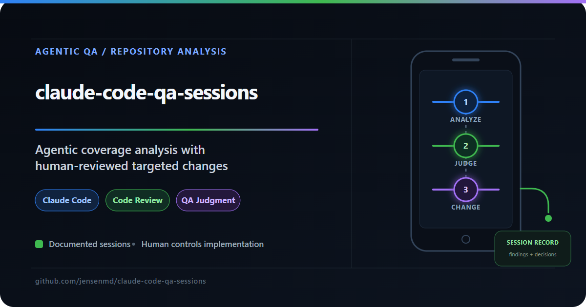

# claude-code-qa-sessions

A record of how I use Claude Code to investigate existing QA repositories and make targeted improvements. Each session shows what the agent found, what I accepted or challenged, and what changed after review.

🔗 [LinkedIn](https://www.linkedin.com/in/michaeljensen-qa/) | 🐙 [GitHub Profile](https://github.com/jensenmd) | 📧 [jensen.md@gmail.com](mailto:jensen.md@gmail.com)

---

## What This Is

Claude Code is an agentic AI tool that reads, reasons about, and modifies codebases autonomously. This repo documents what happens when you point it at existing QA projects — what it finds, what it proposes, and how human judgment shapes the outcome.

The workflow demonstrated here:
1. Claude Code analyzes an existing codebase autonomously
2. Identifies real coverage gaps with specific, actionable suggestions
3. Human evaluates each suggestion with QA judgment
4. Human directs the implementation approach
5. Claude Code implements — human reviews the diff
6. Human commits and pushes

**AI proposes. Human validates. Automation executes.**

---

## Sessions

### Session 1 — restful-booker-qa
**Subject:** Full-stack QA project — REST API testing (Postman/Newman) + UI automation (Playwright)
**Date:** April 28, 2026
**Claude Code Version:** 2.1.122

[→ View Session 1 Details](sessions/restful-booker-qa/README.md)

**What Claude Code found:**
- Weak negative assertion in empty form validation test
- Missing confirmation data verification in happy path test
- Single room type hardcoded across all booking tests

**Human judgment applied:**
- Rejected string-based error message assertions (fragility risk)
- Chose error container visibility assertion instead
- Deferred room type coverage expansion to future session

**Result:** One targeted improvement committed and pushed — stronger test coverage without brittleness.

---

## QA Portfolio Quick Reference

See [Michael D. Jensen’s QA portfolio](https://github.com/jensenmd) for the complete project overview.

| Project | Purpose and Approach |
| --- | --- |
| [fhir-api-qa](https://github.com/jensenmd/fhir-api-qa) | Checks whether a healthcare API preserves Patient data through its lifecycle, with isolated FHIR tests and useful CI failure evidence. |
| [pharmacy-spend-etl-qa](https://github.com/jensenmd/pharmacy-spend-etl-qa) | Checks that pharmacy spend data survives the trip from source files to analytics tables, using SQL reconciliation on a synthetic pipeline. |
| [restful-booker-qa](https://github.com/jensenmd/restful-booker-qa) | Tests booking behavior at both API and browser layers, combining Postman/Newman and Playwright for repeatable regression feedback. |
| [qa-automation-showcase](https://github.com/jensenmd/qa-automation-showcase) | Examines API behavior and the quality of returned data together, using pytest, Postman, and Python validation. |
| [android-appium-wdio-poc](https://github.com/jensenmd/android-appium-wdio-poc) | Builds a focused baseline for Android UI checks, exercising Settings navigation on a local emulator with Appium and WebdriverIO. |
| [mapmyrun-quality-investigation](https://github.com/jensenmd/mapmyrun-quality-investigation) | Investigates how workout tracking affects data integrity and user trust, using mobile field experiments and separating observations from explanations. |
| [ai-qa-framework](https://github.com/jensenmd/ai-qa-framework) | Explores how AI can help develop useful API test coverage while keeping a QA engineer responsible for review and pytest execution. |
| [claude-code-qa-sessions](https://github.com/jensenmd/claude-code-qa-sessions) **(this repository)** | Shows how human QA judgment guides Claude Code from finding coverage gaps to making targeted, reviewed test improvements. |
| [agentqa-orchestrator](https://github.com/jensenmd/agentqa-orchestrator) | Explores inspectable AI code reviews, using Gemini and Pydantic-defined response schemas to produce structured JSON audit artifacts. |

---

## Author

**Michael D. Jensen** — Senior QA Engineer
15+ years of enterprise software testing experience across healthcare IT, financial systems, telecommunications, and cybersecurity.

🔗 [LinkedIn](https://www.linkedin.com/in/michaeljensen-qa/) | 🐙 [GitHub Profile](https://github.com/jensenmd) | 📧 [jensen.md@gmail.com](mailto:jensen.md@gmail.com)
